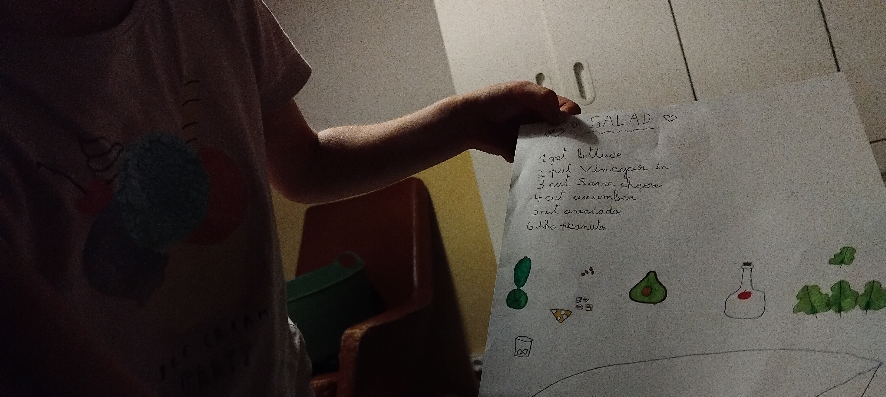

## Recipes

Just the ingredients and a little bit of recipe, thanks, and a picture of Delia.

We believe in Delia.

### Pancake

- Plain flour, sifted - 440 g
- Salt, pinch - 4
- Butter - 200 g
- Eggs - 8
- Milk - 800 ml
- Water - 300 ml

### Crumble

#### Filling

- Apple, pear, blackberry; mix and match
- Sugar - 2 tablespoons

#### Crumble

- Flour - 175 g
- Sugar - 110 g
- Butter - 110 g

### Falafel burgers

Chickpeas 400g 
Red onion, roughly chopped
1 garlic clove
1 tsp ground cumin
1 tsp ground coriander
½ tsp harissa paste or chilli powder
2 tbsp plain flour
2 tbsp sunflower oil

#### Recipe

- Blend chickpeas, onion, garlic, cumin, coriander, harissa paste, flour, salt. 
- Shape into patties.
- Fry for 3 mins on each side until lightly golden. 
- Serve with toasted pitta bread, tomato salsa, and green salad.

### Cheese omelette

- Eggs, 2
- Salt
- Butter
- Cheddar - 15g mature finely grated

#### Recipe

- Whisk eggs.
- Add pinch of salt.
- Heat butter.
- Add eggs.
- Draw in the eggs.
- Sprinkle over the cheese.
- Fold the omelette in half.
- Sprinkle over some black pepper.

### Thai prawn curry

- 1 tbsp vegetable oil
- 1 onion chopped
- 1 tsp fresh root ginger
- 1-2 tsp Thai red curry paste
- 400g can chopped tomatoes
- 50g sachet coconut cream
- 400g raw frozen prawns
- coriander chopped, to serve (optional)

#### Recipe

- Heat the oil.
- Cook onion and ginger until softened.
- Stir in curry paste, cook for 1 min.
- Pour over the chopped tomatoes and coconut cream.
- Bring to the boil.
- Simmer for 5 mins (add boiling water if the mixture gets too thick).
- Tip in prawns.
- Cook for 5-10 mins.
- Serve with rice.

### Teriyaki chicken

- 2 tbsp toasted sesame oil
- 6 skinless and boneless chicken thighs
sliced
- 2 large garlic cloves
crushed
- 1 thumb-sized piece ginger
grated
- 50g honey
- 30ml light soy sauce
- 1 tbsp rice wine vinegar

#### Recipe

- Heat the oil in a non-stick pan over a medium heat.
- Add the chicken and fry for 7 mins, or until golden.
- Add the garlic and ginger and fry for 2 mins.
- Stir in the honey, soy sauce, vinegar and 100ml water.
- Bring to the boil and cook for 2 - 5 mins until the chicken is sticky and coated in a thick sauce.
- Scatter over the spring onions and sesame seeds.
- Serve with rice and steamed veg.

#### To serve
- 1 tbsp sesame seeds
to serve
- 4 spring onions
shredded, to serve
- sticky rice
to serve
- steamed bok choi
or spring greens, to serve

### Spicy chicken & avocado wrap

- Chicken breast, thinly sliced
- Squeeze hal a lime
- Half teaspoon mild chilli powder
- Chopped garlic clove
- Teaspoon olive oil
- Avocado, halved, stoned, chopped
- Red pepper, roasted or fried
- Wraps

#### Recipe

- Mix chicken, lime juice, chilli powder, and garlic.
- Heat oil.
- Fry chicken and peppers.
- In the wrap, add everything.

### Saoirse's salad

Saoirse has invented a salad recipe.

### Cinnamon Rolls

Dough

- 50 g granulated sugar
- 344 g all-purpose flour
- 1/2 teaspoon salt
- 180 ml milk
- 43 g butter
- 1 standard packet yeast
- 1 large egg

Filling

- 43 g butter, softened
- 67 g brown sugar
- 1 Tablespoon cinnamon

Icing

- 113 g cream cheese
- 28 g butter
- 80 g glazing sugar
- 1 teaspoon vanilla extract

#### Recipe

##### Dough

- Blend milk and warmed butter.

- Mix in yeast until it dissolves.

- Add the sugar, flour, salt, and egg.

- Whisk together.

- Transfer dough to a lightly floured surface. 

- Knead the dough for 3-5 minutes.

- Place in a lightly greased bowl and cover loosely for 10 minutes.

- Roll dough out into a rectangle.

##### Filling

- Spread the softened butter on top.

- Mix together the cinnamon and brown sugar.

- Sprinkle it over the dough.

##### Rising

- Roll up the dough into a log.

- Cut into 10–12 even rolls.

- Transfer to a lightly greased baking tray.

- Cover with a kitchen towel and leave in a warm place for 60–90 minutes.

##### Icing

- Whisk cream cheese, butter, glazing sugar, and vanilla.

##### Baking

- Bake the rolls for 10-27 minutes at 190°C, until lightly browned.

- Transfer to a wire rack.

- Spread the icing over the warm rolls and serve immediately.

